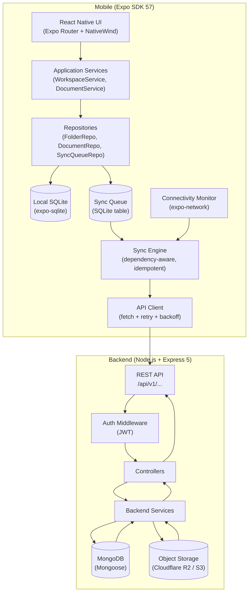

# FolioSync — Architecture

## Overview

FolioSync is an offline-first document and workspace manager. The architecture is split into two autonomous layers:

- **Layer A — Mobile Autonomous Layer**: owns local state, never blocks the user on network
- **Layer B — Cloud Backend**: becomes the source of truth after synchronization

---

## System Architecture Diagram



---

## Layer A — Mobile Autonomous Layer

### Data Flow (Write)

```
User Action
    ↓
Application Service
    ↓
SQLite Transaction (atomic):
    ├── Upsert entity (folder / document)
    └── Insert sync_queue record
    ↓
Commit
    ↓
UI updates from SQLite (immediate)
    ↓
Sync Engine notified (async, non-blocking)
```

### Data Flow (Read)

```
UI
 ↓
Repository.query(SQLite)
 ↓
Return rows
 ↓
UI renders
```

No network call is ever required for local reads or writes.

---

## Layer B — Cloud Backend

### Sync Batch Flow

```
Sync Engine
    ↓
Reads pending sync_queue items
    ↓
Resolves dependency order (parent before child)
    ↓
For each item:
    ├── POST /api/v1/sync/batch  (with Idempotency-Key header)
    ├── Server processes idempotently
    ├── Returns { clientId, serverId } mappings
    ├── Mobile updates server_id on local entity
    ├── Mobile updates dependent queue payloads
    └── Mark queue item as "synced"
```

---

## Database Schema (SQLite)

### users
```sql
id TEXT PRIMARY KEY,          -- UUID
email TEXT UNIQUE NOT NULL,
display_name TEXT NOT NULL,
access_token TEXT,
refresh_token TEXT,
token_expires_at INTEGER,
created_at INTEGER NOT NULL,
updated_at INTEGER NOT NULL
```

### folders
```sql
id TEXT PRIMARY KEY,          -- client UUID
server_id TEXT,               -- populated after sync
parent_id TEXT,               -- references folders.id (client UUID)
name TEXT NOT NULL,
path_cache TEXT,
sync_status TEXT NOT NULL,    -- pending|syncing|synced|failed|needs_attention
created_at INTEGER NOT NULL,
updated_at INTEGER NOT NULL,
deleted_at INTEGER
```

### documents
```sql
id TEXT PRIMARY KEY,          -- client UUID
server_id TEXT,
folder_id TEXT NOT NULL,      -- references folders.id (client UUID)
name TEXT NOT NULL,
mime_type TEXT NOT NULL,
local_uri TEXT,
storage_key TEXT,
file_size INTEGER,
content_hash TEXT,
imported_at INTEGER NOT NULL,
updated_at INTEGER NOT NULL,
sync_status TEXT NOT NULL,
deleted_at INTEGER
```

### sync_queue
```sql
id TEXT PRIMARY KEY,          -- UUID (used as idempotency key)
entity_type TEXT NOT NULL,    -- folder|document
operation TEXT NOT NULL,      -- create|rename|move|delete
payload TEXT NOT NULL,        -- JSON
client_entity_id TEXT NOT NULL,
status TEXT NOT NULL,         -- pending|syncing|synced|failed|needs_attention
retry_count INTEGER DEFAULT 0,
last_error TEXT,
next_retry_at INTEGER,
created_at INTEGER NOT NULL
```

---

## Sync Engine — Dependency Resolution

The sync engine processes queue items in dependency order, not FIFO.

```
Example queue:
  [folder:create A]
  [folder:create B (parent=A)]
  [document:create X (folder=B)]

Resolution order:
  1. folder:create A  → get A.serverId
  2. folder:create B  → substitute A.serverId into payload → get B.serverId
  3. document:create X → substitute B.serverId into payload → upload file
```

An item is only dispatched when all its parent dependencies have `server_id` populated.

---

## Conflict Resolution

### Case A — Concurrent Rename

Two devices rename the same folder while one is offline.

**Policy: Last-write-wins by server timestamp.**

- The offline device syncs its rename with the server timestamp of the sync moment.
- The server compares `updatedAt` timestamps.
- The later timestamp wins.
- The losing device receives the winning name on next workspace snapshot pull.
- Conflict metadata is retained in the local `sync_queue` record for audit.

### Case B — Delete/Import Conflict

Folder deleted offline on Device A. Document imported into that folder offline on Device B.

**Policy: Document is preserved in a `lost-and-found` root folder.**

- If folder deletion reaches server first:
  - Server moves any documents in that folder to a system `lost-and-found` folder owned by the user.
  - Document is not lost.
- If document sync reaches server first:
  - Document is created normally.
  - Folder deletion then cascades per the server's cascade policy (document moves to `lost-and-found`).

### Case C — Duplicate Document Import

Same file imported twice (same device or two devices).

**Prevention strategy:**
1. Client generates a deterministic import UUID from: `SHA-256(filename + fileSize + lastModified)`.
2. This UUID is used as the `clientId` for the document.
3. Server has a unique index on `(ownerId, clientId)`.
4. Duplicate import attempts return the existing record (idempotent).

---

## Authentication

- Access token: JWT, short-lived (15 minutes)
- Refresh token: opaque token, hashed with Argon2 in DB, long-lived (30 days)
- Tokens stored in `expo-secure-store` on device
- Refresh happens transparently in the API client interceptor

---

## Object Storage

Files (PDF, DOCX) are stored in Cloudflare R2.

Storage key format:
```
users/{userId}/documents/{documentClientId}/{safeFilename}
```

MongoDB stores only the `storageKey`. The API generates pre-signed URLs for download.

---

## File Structure

```
folio-sync/
├── apps/
│   ├── mobile/          ← Expo SDK 57 application
│   └── backend/         ← Express 5 + TypeScript API
├── docs/
│   ├── architecture.md
│   ├── api.md
│   ├── conflict-resolution.md
│   ├── decisions.md
│   └── version-report.md
├── .github/
│   └── workflows/
└── README.md
```
